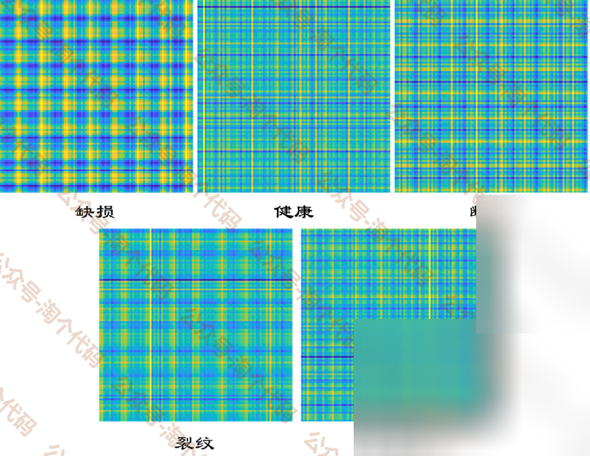
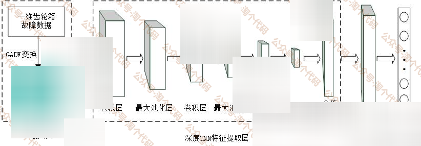
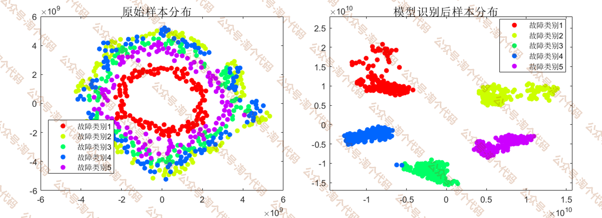
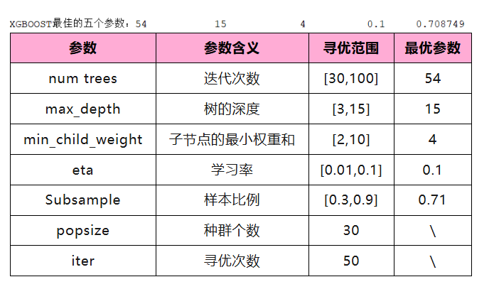
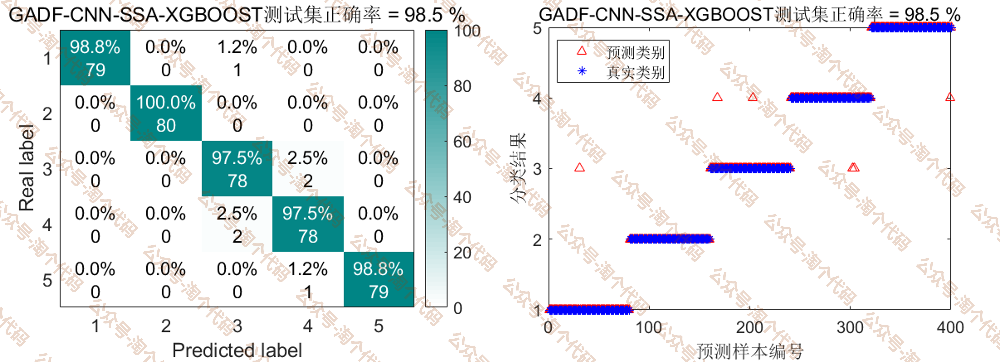
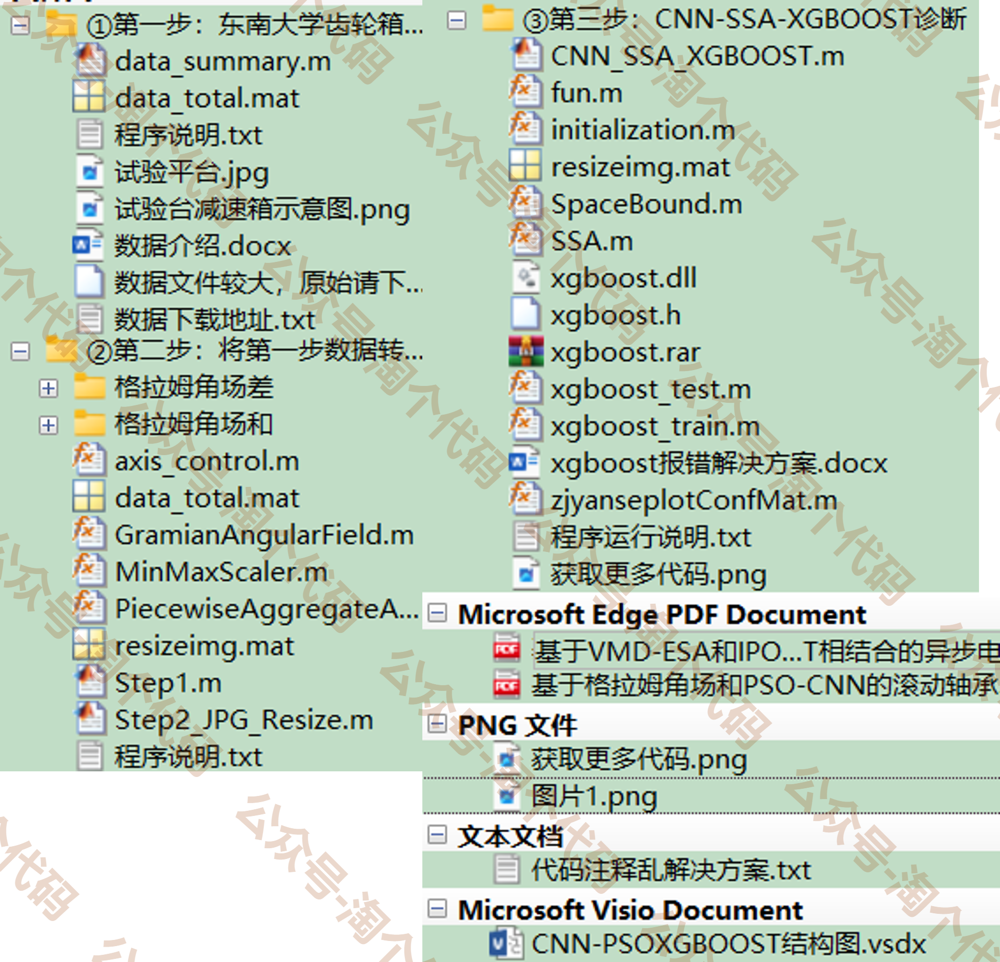

# Seeking publication! Professional tutorial on GADF-CNN-SSA-Xgboost, gearbox fault diagnosis in Southeast University, MATLAB code, highly recommended!

The theme of this article is...
Firstly, utilizing the high time-frequency resolution of Gram-Schmidt Angular Form (GADF), which can deeply reflect the intrinsic structure and relationship of time series, the one-dimensional fault data signal collected is converted into a two-dimensional image. After obtaining the image, it undergoes dimensionality reduction processing.
Input the Gram angle field difference image obtained in the first step into a two-dimensional convolutional neural network (CNN) for adaptive fault feature extraction.
Take the fully connected layer output of CNN as the input for Xgboost classifier, and use the classic Sparrow algorithm to optimize the five key parameters of Xgboost classifier (Xgboost hyperparameters: number of trees, depth of tree, minimum weight of sub-node, learning rate, sample ratio).
This tweet is based on gearbox data from Southeast University for experimental purposes. The experiment shows that the method can achieve a diagnostic accuracy of over 98%.
Content details
1. Data Processing
1. Briefly process and label the gearbox data downloaded from Southeast University official website as follows:
The gearbox data are selected from the following five types:
'Chipped_20_0.csv' gear has cracks
'Health_20_0.csv' is running normally.
'Miss_20_0.csv' has broken teeth
Cracks at the root of gear teeth
'Surface_20_0.csv' tooth surface wear
Extract the third column of these five data sets, and consolidate them into a `data_total.mat` file. This file contains 5 types of faults, with a total of 1000 samples. Set each type of sample to 200, and each sample to have 2048 points. Use a sliding window approach to select data, with a window size of 2048 and a step size of 1000.
② Utilize Gram-Schmidt Orthogonalization (GADF) to transform data into time-frequency diagrams.
\n        \n  
③ Input the constructed feature vectors into different models for training and testing.
\n        \n  
II. Results Display
Gearbox Fault Diagnosis Result of Southeast University:
The first 120 groups of each state are used for training, and the last 80 groups are used for testing. The t-sne distribution comparison chart before and after GADF-CNN feature extraction is as follows:
\n        \n  
The classical sparrow algorithm is used to optimize the hyperparameters of the xgboost classifier. The parameter settings and optimization results are as follows:
\n        \n  
Classification result graph:
\n        \n  
It can be seen that the precision rate of the method proposed in this paper has reached 98.5%, which demonstrates the effectiveness of the method!
All the above images can be run.
The network structure is drawn using Visio diagrams.
Code Directory
\n        \n  
The code organization is very meticulous! It ensures that even beginners can understand it, with each step accompanied by a program description in .txt files. Follow the steps and instructions step by step.
References:
Gao Meng, Zeng Xuanwen. Failure Diagnosis of Asynchronous Motors Based on the Combination of VMD-ESA and IPOA-XGBOOST [J]. Modern Electronic Technology, 2024, 47(2):115-120.
Gao Meng, Zeng Xuanwen. Fault Diagnosis of Asynchronous Motors Based on Combined VMD-ESA and IPOA-XGBOOST [J]. Modern Electronic Technology, 2024, 47(2):115-120. DOI:10.16652/j.issn.1004-373x.2024.02.022.
This program has been included in the entire family of diagnostics tools!

## Images

<!-- PAYMENT_BLOCK -->

## Get this dataset

- Payment link (Stripe): [Buy now](https://buy.stripe.com/3cs8yP7sY87d0vu9AB)
- Payment QR code: 

<!-- /PAYMENT_BLOCK -->
